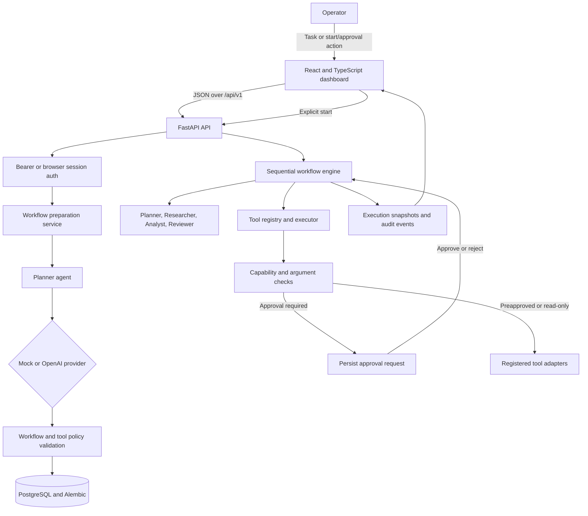

# AgentForge

AgentForge is a self-hosted operator application that turns a natural-language task into a validated, inspectable workflow. It provides a bounded sequential execution engine, role-specific agents, explicitly registered tools, approval gates, PostgreSQL history, and a React dashboard.

This repository is a local/private MVP. It is not a general-purpose autonomous computer-use agent, a code-generation runtime, or a production-ready multi-tenant service.

## What it does

- Prepares planner-generated JSON workflows from operator task text.
- Validates workflow schemas, dependency DAGs, task limits, role allowlists, and tool permissions before persistence.
- Executes eligible steps sequentially without granting agents direct control of the tool registry.
- Supports the deterministic mock provider and an opt-in OpenAI Planner adapter.
- Provides text analysis, JSON inspection, calculator, and read-only English Wikipedia search tools.
- Requires explicit operator approval for approval-gated actions and binds it to the execution, task, tool, and canonical argument digest.
- Persists workflow definitions, execution state, task results, approval requests, events, and final status in PostgreSQL.
- Displays workflow graphs, execution history, task results, events, and approval controls in the React dashboard.

## Architecture



Planning creates a validated, pending workflow and execution. It does not execute tasks or tools. Starting a pending execution is a separate explicit action. For a complete code-mapped description, see [Architecture](docs/ARCHITECTURE.md) and [Threat Model](docs/THREAT_MODEL.md).

## Technology stack

| Area | Technology |
| --- | --- |
| API | Python 3.11-3.14, FastAPI, Pydantic, SQLAlchemy |
| Database | PostgreSQL 16, psycopg, Alembic |
| Workflow | Typed agent interfaces, versioned Pydantic contracts, bounded sequential engine |
| Frontend | React 19, TypeScript, Vite, Tailwind CSS, React Router |
| Containers | Docker and Docker Compose, Nginx |
| Quality | pytest, Ruff, Vitest, Testing Library, GitHub Actions |

## Repository structure

```text
.
├── backend/             FastAPI package, tests, migrations, Docker configuration
├── frontend/            React/Vite dashboard and frontend tests
├── docs/                Product, architecture, roadmap, and threat model
├── scripts/             Development documentation and utilities
├── tests/               Reserved cross-package integration test area
├── .github/workflows/   Backend and frontend CI
├── .env.example         Placeholder local environment configuration
└── docker-compose.yml   PostgreSQL, backend, and frontend local stack
```

## System requirements

- Windows PowerShell, macOS, or Linux
- Python 3.11 through 3.14
- [uv](https://docs.astral.sh/uv/)
- Node.js 22.12 or newer and npm
- PostgreSQL 16, or Docker Desktop/compatible Docker Engine with Compose
- Optional: an OpenAI API key only for `PROVIDER_MODE=openai`

## Local setup

### 1. Configure environment

From the repository root:

```powershell
Copy-Item .env.example .env
```

Replace placeholder database passwords and secrets before use. Keep the mock provider for offline development:

```dotenv
APP_ENV=development
LOG_LEVEL=INFO
CORS_ORIGINS=["http://localhost:5173"]
VITE_API_BASE_URL=/api/v1
PROVIDER_MODE=mock
OPENAI_API_KEY=
OPENAI_MODEL=gpt-4o-mini
OPENAI_TIMEOUT_SECONDS=30
API_ACCESS_TOKEN=
SESSION_SIGNING_SECRET=replace-with-a-random-secret-at-least-32-characters
```

`CORS_ORIGINS` must be a JSON array and must not contain `*`. Never put secrets in `VITE_*` variables.

### 2. Start PostgreSQL

The database-only Compose service is the simplest setup:

```powershell
docker compose -f backend/docker-compose.yml --env-file .env up -d
```

Alternatively, use an existing PostgreSQL 16 instance and set matching `DATABASE_URL` and `TEST_DATABASE_URL` values in `.env`.

### 3. Install dependencies and migrate

```powershell
python -m uv --directory backend sync --all-groups
npm --prefix frontend ci
python -m uv --directory backend run alembic upgrade head
```

Alembic migrations live in `backend/migrations/versions/`. The test database is separate: create `agentforge_test` before running backend tests if your PostgreSQL instance does not use the Docker initialization scripts.

### 4. Start the backend

```powershell
python -m uv --directory backend run uvicorn agentforge.main:app --reload
```

Health endpoints:

- `http://127.0.0.1:8000/api/v1/health`
- `http://127.0.0.1:8000/api/v1/ready`

### 5. Start the frontend

In a second terminal:

```powershell
npm --prefix frontend run dev
```

Open `http://localhost:5173`. The Vite development server proxies `/api` to `http://127.0.0.1:8000`.

## Docker Compose

The root Compose stack builds PostgreSQL, the API, and the dashboard:

```powershell
Copy-Item .env.example .env
# Set POSTGRES_PASSWORD, API_ACCESS_TOKEN, and SESSION_SIGNING_SECRET
docker compose --env-file .env up --build
```

Open `http://localhost:5173`. The Compose path is for local development and verification, not production deployment.

Docker was not available while preparing this release documentation. Verify the stack on a machine with Docker before presenting it as a deployment result.

## Provider and tool behavior

- `PROVIDER_MODE=mock` is the default and requires no external credentials.
- `PROVIDER_MODE=openai` requires `OPENAI_API_KEY` and a protected API with `API_ACCESS_TOKEN` of at least 32 characters.
- OpenAI mode sends only the Planner task description to the configured provider.
- Wikipedia search sends only a 1-200 character query to the fixed English Wikipedia API endpoint after execution starts.
- The registered mock tools are text analysis, JSON inspection, calculator, and Wikipedia search.
- Planning and workflow review do not invoke tools.

Do not submit credentials or sensitive content as tasks, workflow inputs, or tool arguments.

## Testing

Backend:

```powershell
python -m uv --directory backend run ruff check .
python -m uv --directory backend run pytest
```

Frontend:

```powershell
npm --prefix frontend test
npm --prefix frontend run typecheck
npm --prefix frontend run build
```

GitHub Actions runs backend tests on Python 3.11 and 3.14, plus frontend tests, typechecking, and production build. Backend persistence tests require PostgreSQL.

## Screenshots

Current repository screenshots are not available.

- [ ] Add an application dashboard screenshot at `docs/images/dashboard.png`.
- [ ] Add a workflow preparation and plan screenshot at `docs/images/workflows.png`.
- [ ] Add an execution detail, approval, and graph screenshot at `docs/images/execution-approvals.png`.

Only add screenshots created from a real local run; do not fabricate demo data or deployment metrics.

## Current limitations

- Mock mode remains deterministic, while OpenAI-generated planning content is not reproducible.
- The in-process engine does not rehydrate or resume active executions after an API restart.
- There is no distributed worker, scheduling service, or exactly-once external side-effect guarantee.
- Browser sessions use a process-local registry and do not support logout revocation across multiple API workers.
- Authentication is shared-operator credential/session authentication, not per-person identity, MFA, or RBAC.
- No general-purpose shell, file, browser, code-evaluation, or arbitrary network tool is implemented.
- Wikipedia is the only external network tool and is read-only.
- Raw task and tool arguments are intentionally restricted in safe frontend projections.
- No backups, monitoring, metrics platform, retention automation, or production deployment has been implemented or verified.
- The repository has no selected open-source license.

## Roadmap

The next work should remain milestone-gated:

1. Verify and harden private deployment, backups, recovery, monitoring, transport security, and container security.
2. Resolve process-local session limitations before multi-worker or replica support.
3. Add real side-effect tools only with typed schemas, policy review, idempotency contracts, and focused tests.
4. Add controlled parallelism and distributed claims only after crash/recovery semantics are implemented.
5. Add multi-user identity and authorization only after the threat model is redesigned.

See [Roadmap](docs/ROADMAP.md) for milestone details.

## Security considerations

- Treat task text, provider output, and tool output as untrusted.
- Keep workflow fields declarative; the engine never interprets them as code or shell commands.
- Registration, capability checks, typed schemas, and approval binding are enforced server-side.
- Production requires HTTPS, explicit HTTPS CORS origins, strong operator and session secrets, and same-origin API routing.
- Approval waits and action arguments are persisted; changed arguments cannot reuse an existing grant.
- OpenAI and Wikipedia integrations share no arbitrary URL or credentials mechanism.
- Run a dependency and container review before public exposure.
- A complete security review is documented in [Threat Model](docs/THREAT_MODEL.md).

## Contributing

Before changing behavior:

1. Read the product specification and architecture documents.
2. Preserve deny-by-default tool policy and explicit execution approval.
3. Add focused backend/frontend tests for introduced behavior.
4. Run backend lint/tests and frontend tests/typecheck/build.
5. Run `git diff --check`.

## License

No license has been selected. [LICENSE](LICENSE) reserves all rights and grants no reuse or distribution permission. Do not claim the project is open source until maintainers add an approved license.
