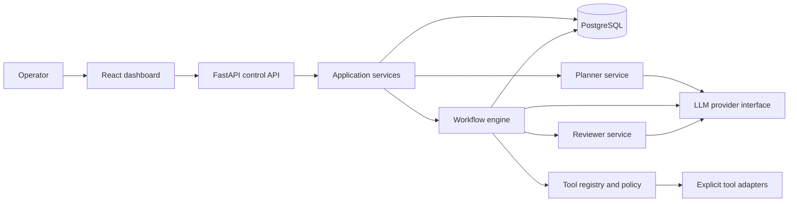
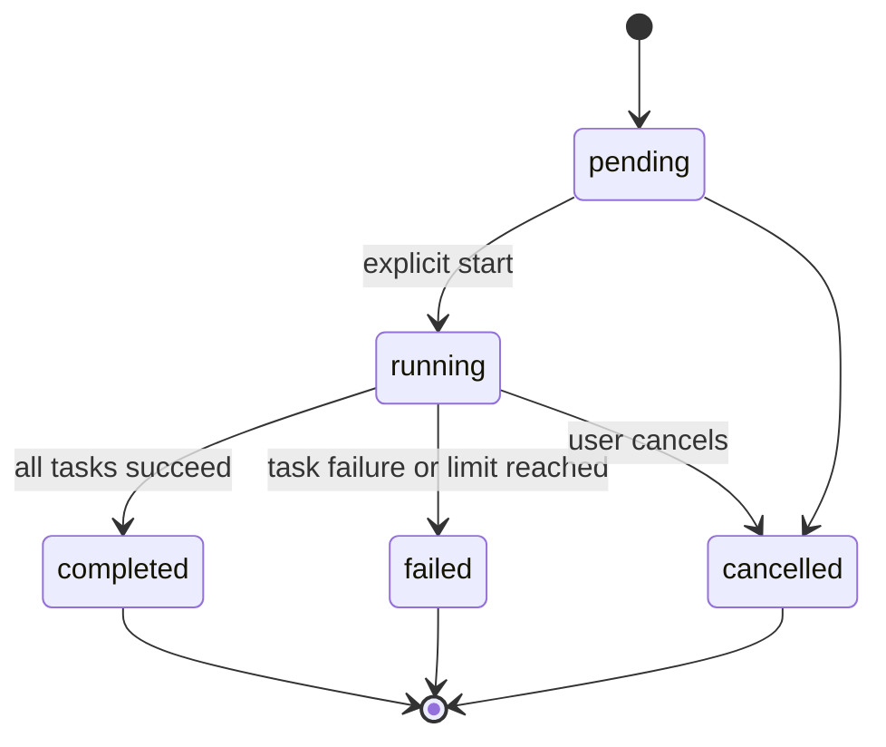
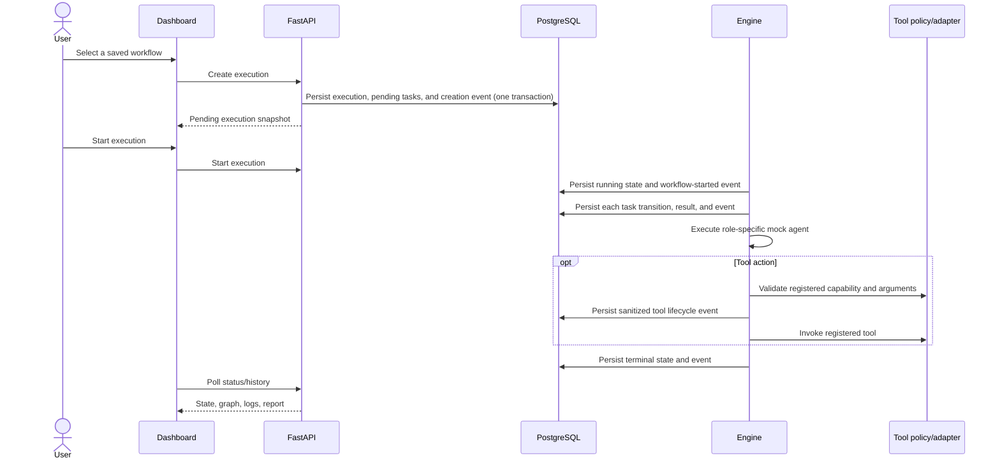

# AgentForge Architecture

## System boundaries

AgentForge separates planning, workflow policy, execution, and provider/tool integrations. Agents are role-specific prompts/adapters invoked by the engine; they are not independent processes with authority to select arbitrary capabilities.

### Component responsibilities

| Component | Owns | Must not own |
|---|---|---|
| React dashboard | Task entry, plan/graph display, start/approve/reject actions, history and logs | Provider credentials, workflow policy decisions, direct tool invocation |
| FastAPI API | Request validation, operator-facing endpoints, auth boundary, service orchestration, response shaping | Agent prompts, DAG scheduling internals, arbitrary execution |
| Pydantic contracts | Versioned request/plan/step/tool/result/state shapes and validation, plus provider-neutral agent input/output contracts | Persistence or side effects |
| Planner service | Convert task to proposed structured plan through provider interface | Executing plans or tools |
| Workflow engine | Validate transitions and dependency readiness, schedule bounded sequential tasks, emit detached lifecycle snapshots | SQLAlchemy/database access, provider-specific API details, generated code execution |
| Agent roles | Implement the common typed interface and produce bounded structured outputs for assigned work using only supplied context | Self-directed scheduling, direct registry bypass, or provider-specific SDK behavior in domain contracts |
| Tool registry/policy | Resolve registered tool, validate arguments, classify risk, enforce approval and idempotency policy | Allowing tools based solely on model output |
| Provider adapters | Translate provider-neutral requests/results to mock or external LLM APIs | Workflow state, tool permissions, persistence |
| Persistence/repositories | Store versioned workflows, execution/task snapshots, and ordered audit events | Deciding whether a plan is safe or validating state transitions |
| Synchronous API runner | Invoke the engine and commit each lifecycle snapshot before returning it as durable | Background scheduling, restart recovery, or exactly-once side effects |

## Workflow representation

A plan is versioned JSON validated with Pydantic. Each step has a stable ID, role, instruction, declared dependency IDs, typed input/output contract, and optional registered tool request. The in-memory engine accepts all four existing roles. The Planner creates a draft; it does not itself validate or execute a workflow. `WorkflowOrchestrator.prepare()` translates the ordered draft into a declarative workflow, adds a final Reviewer task when criteria are supplied, and registers it through the engine's full validator. The resulting execution remains pending until explicit `start()`. Tool requests are not generated by the Planner. A task may declare at most one tool request, which the engine preflights and dispatches through the controlled executor; further tool actions require subsequent declared tasks. Dependencies form a directed acyclic graph.

Plan validation includes:

- schema/version and size limits;
- unique IDs, valid role and tool identifiers;
- valid, non-self dependencies and acyclic graph;
- references only to declared prior outputs;
- bounded prompt/input/output sizes;
- capability checks independent of model intent.

The workflow engine executes sequentially in stable plan order among ready steps. This makes scheduling reproducible and limits initial concurrency/resource complexity. Provider-generated text can still vary.

## Lifecycle and state transitions

State transitions are validated centrally by `WorkflowEngine`. The persistence adapter does not duplicate transition rules; each accepted engine snapshot and its newly appended events are committed together. A transition record includes execution, prior/new state, timestamp, system source, and a safe reason. The current engine does not retry tasks.

**Restart behavior:** execution records, steps, results, timestamps, and ordered events survive API restarts and can be retrieved/listed from PostgreSQL. The in-memory engine does not rehydrate active executions, so a pending or interrupted execution cannot be started or resumed after restart; no recovery worker or durable claim is implemented. Exactly-once external effects are not promised.

## Data flow

## Persistence model (logical)

- **Execution:** ID, original task, state, plan/schema version, provider mode (not credential), timestamps, terminal reason, report.
- **Workflow:** named, versioned validated definition, stored as PostgreSQL JSONB.
- **Workflow step attempt:** execution ID, stable task ID, role, attempt number, input/output JSONB, state, timing, sanitized error.
- **Approval request:** execution/step, action digest, safe display arguments, status, decision time.
- **Tool execution:** execution/step, registered tool name, state, safe input/output summaries, timing.
- **Audit event:** append-only state changes, plan start, approval decisions, and tool invocation outcomes.

Use SQLAlchemy 2.x and Alembic migrations. Store structured data as typed relational fields plus JSONB where appropriate; do not make an unvalidated JSON blob the sole state representation. Lifecycle event details are allowlisted and omit tool payloads and nested failure details. Workflow task inputs and successful task outputs are stored as JSON for reconstruction; there is no general-purpose secret redactor or retention policy yet, so credentials and data that must not persist must not be submitted.

The SQLAlchemy schema is in `backend/app/agentforge/domain/models/`. It uses
UUID primary keys, PostgreSQL JSONB for workflow/task data, foreign keys with
explicit delete behavior, and Alembic migrations. The execution model retains
nullable workflow references for other lifecycle use cases; executions created
from the workflow API always record the workflow ID and version. The MVP's
authentication mechanism remains unresolved; the initial users table stores
only a unique email and does not store a password hash.

## Agent contracts and Day 6 implementations

Provider-neutral agent identity, input, output, execution-result, and error
contracts live in `backend/app/agentforge/domain/agents/`. They use Pydantic
validation and JSON-compatible structured data and do not depend on FastAPI,
the persistence models, or provider SDKs. The common synchronous `Agent`
interface exposes identity, supported capabilities, input validation, and an
execution method returning the same `AgentExecutionResult` shape for each
role. Failed executions preserve a categorized error in both the execution
result and its output.

The Planner produces a non-executable single-step draft; the Researcher only
returns supplied information; the Analyst reports top-level JSON types; and
the Reviewer performs literal criterion-presence checks. These deterministic
mocks make no network calls and do not claim semantic analysis, real research,
workflow validation, workflow execution, or agent-to-agent orchestration.

## API and worker boundary

The Day 11 API exposes versioned workflow definitions and the existing in-process execution engine:

| Method | Path | Behavior |
|---|---|---|
| `POST` | `/api/v1/workflows` | Validate a definition and persist it as the next version for its name. |
| `GET` | `/api/v1/workflows` | List persisted definitions with `limit` and `offset`. |
| `GET` | `/api/v1/workflows/{workflow_id}` | Retrieve a persisted definition and version. |
| `POST` | `/api/v1/workflows/validate` | Validate a definition and its declared tool permissions without persisting it. |
| `POST` | `/api/v1/workflows/{workflow_id}/executions` | Persist a pending execution, initial task rows, and creation event; no agent or tool runs yet. |
| `POST` | `/api/v1/executions/{execution_id}/start` | Start a pending execution synchronously through the orchestrator and engine. |
| `GET` | `/api/v1/executions` | List persisted executions with database pagination and optional status/name/ID filters. |
| `GET` | `/api/v1/executions/{execution_id}` | Reconstruct status, task results, events, timestamps, and execution order from PostgreSQL. |
| `POST` | `/api/v1/executions/{execution_id}/cancel` | Cancel pending work or request cooperative cancellation of running work. |

The Day 13 dashboard slice replaces execution-history fixtures with the
persisted list and detail APIs. History is paginated and can be filtered by
status or case-insensitive workflow-name/execution-ID search. Opening a row
loads task states, safe error messages, and ordered lifecycle events; raw task
payloads and tool arguments are not rendered. List and detail failures remain
visible with retry controls. Day 14 extends execution detail with a safe plan
projection containing only task IDs, agent roles, dependency IDs, and persisted
task states. The dashboard renders that projection as a dependency graph and
an accessible textual summary; inputs, tool arguments, task descriptions, and
outputs are not part of the projection. Workflow authoring, approval handling,
and active execution recovery remain outside this slice. The Vite development
server proxies `/api` to the local API; deployed frontends must route the same
path.

### Day 15 — OpenAI Planner and Wikipedia search

The roadmap is milestone-based and does not define a calendar Day 15. Following
the Day 14 graph view, this increment begins M3 with the operator-selected
OpenAI provider and Wikipedia read-only integration:

- `PROVIDER_MODE=mock` remains the default. `PROVIDER_MODE=openai` replaces
  only the Planner agent with an OpenAI Chat Completions adapter. The provider
  endpoint is fixed; no arbitrary base URL or provider-selected tool call is
  supported. The adapter sends only `AgentInput.task_description`, requests a
  JSON object, caps the response body and completion size, and validates the
  result as a non-executable plan with at most 25 steps. It does not send
  `input_data`, previous results, or metadata. Provider errors are categorized
  and sanitized; 429/5xx/transient failures are marked retryable but are not
  automatically retried.
- When OpenAI mode is enabled, all workflow and execution API routes require a
  shared bearer token from `API_ACCESS_TOKEN`; health/readiness endpoints stay
  public. The token is held as a secret setting and compared in constant time.
  This is a single-operator safeguard, not user identity, per-user
  authorization, or a substitute for transport security.
- `wikipedia_search` is an explicitly registered Researcher-capability tool.
  It accepts a 1–200 character search query, issues a GET only to the fixed
  English Wikipedia API, and returns at most five excerpts (400 characters
  each) with bounded article titles and canonical source links. It does not accept a
  URL, follow agent-selected capabilities, or perform writes. The request has
  an eight-second network timeout; the existing executor also enforces its
  configured elapsed-time and output-size limits. As with all workflow inputs,
  queries and results may be persisted; credentials or sensitive data must not
  be submitted.
- Both network integrations are exercised with mocked HTTP responses in tests.
  Runtime calls require explicit workflow start. The OpenAI key comes from
  `OPENAI_API_KEY` and is held as a secret setting; it is not included in
  workflow data, logs, or API responses.

Workflow definitions use the domain Pydantic contracts and validator; tool
requests are preflighted through the engine's registered-tool and capability
checks. Invalid definitions return `422`, missing resources return `404`, and
invalid execution transitions return `409`. Request bodies are limited to
1 MiB. Responses are explicit Pydantic API contracts, not SQLAlchemy objects,
and error responses do not include raw exception details.

Workflow definitions use the existing `workflows` model and `(name, version)`
uniqueness convention. Execution persistence uses the existing
`workflow_executions`, `execution_steps`, and `execution_events` tables through
`ExecutionRepository`; it adds no duplicate execution tables. The adapter is
outside the engine and receives detached Pydantic snapshots through an optional
callback. The engine remains independent of SQLAlchemy and authoritative for
workflow/task transitions.

Creation commits the execution, version reference, all pending task rows, and
the `workflow_created` audit event in one transaction before the engine
registers it in memory. Start, task, tool, failure, cancellation, and terminal
snapshots each commit their state changes, step results/timestamps, and newly
appended audit events in one transaction. A per-execution event sequence
preserves append order and prevents duplicate writes. If a transaction fails,
the request fails; the adapter does not claim the uncommitted state as durable
and does not automatically retry execution or tool calls.

Retrieval validates and reconstructs detached API-domain snapshots from the
workflow definition, execution row, task rows, and ordered events. Listing is
database-paginated. The API does not expose a state mutation endpoint.
Execution starts synchronously and blocks its HTTP request. Cancellation is
cooperative and cannot interrupt an active synchronous agent/tool call.
Restarted processes can retrieve/list durable history, but active/pending
records are not rehydrated into the engine and cannot be resumed or cancelled
through this API. A background worker, automatic recovery, and exactly-once
external side effects are not implemented.

An agent/tool side effect and its subsequent database transaction cannot be
made atomic. If persistence fails after a side effect, the durable snapshot
remains at its last successful commit and the API returns an error; an operator
must treat the outcome as ambiguous rather than retrying automatically.

## Failure handling

| Failure | Required behavior |
|---|---|
| Malformed or unsafe planner output | Reject before execution, persist validation issue, expose actionable error. |
| Provider unavailable, rate-limited, or timed out | Classify error; bounded retry only for transient failures; expose attempts and terminal reason. |
| Tool schema/policy rejection | Do not invoke tool; record denial and fail or pause with clear reason. |
| Approval rejected or expires | Do not invoke gated action; persist decision/expiry and terminate or require replanning. |
| Tool timeout after possible side effect | Treat outcome as ambiguous; do not automatically repeat unless idempotency contract guarantees safe retry. |
| Database unavailable | Fail closed at the next engine boundary; surface persistence failure without reporting the new state as durable. |
| Process restart | Preserve persisted history; active work is not automatically resumed and may remain incomplete for operator inspection. |
| Reviewer rejects result | Mark execution failed/review-rejected and show assessment; do not return success. |
| Cancellation | Stop scheduling new steps; cooperative cancellation for active calls; record if an in-flight side effect outcome is unknown. |

## Initial architectural decisions

| ID | Decision | Rationale / consequence |
|---|---|---|
| AD-01 | Represent workflows as versioned Pydantic-validated data, never generated code. | Keeps plans inspectable and prevents code execution from being an implicit capability. |
| AD-02 | Keep planning separate from user-authorized execution. | Prevents a generated plan from immediately causing effects and enables review. |
| AD-03 | Engine owns deterministic sequential scheduling and state transitions. | Makes dependency ordering and recovery testable; parallelism is deferred. |
| AD-04 | Keep provider adapters behind a provider-neutral interface; use a deterministic mock by default in tests/dev. | Core orchestration does not depend on paid APIs or vendor-specific behavior. |
| AD-05 | Tools are explicit registered adapters with typed schemas and deny-by-default policy. | LLM output cannot create new capabilities. Shell/exec tools are excluded. |
| AD-06 | Gate sensitive/external side effects on approval bound to canonical action arguments. | Approval must not authorize a materially changed action. |
| AD-07 | PostgreSQL is the durable source for persisted execution snapshots and workflow definitions; the synchronous engine remains the transition authority. | API snapshots survive restart, but active engine work is not rehydrated; worker infrastructure and exactly-once side effects remain deferred. |
| AD-08 | MVP targets one trusted operator on a local machine; private-network exposure requires an agreed authentication mechanism. | Avoids pretending minimal MVP controls meet SaaS isolation requirements. |
| AD-09 | Initial limits: 25 steps, 2 retries, 60-second attempts, 15-minute active execution, 10,000-character task, 24-hour approval expiry, and one tool request per step. | Provides testable guardrails; operators can lower these limits. |

## Unresolved questions

1. Which additional LLM providers are required beyond the initial OpenAI Planner adapter?
2. Which additional read-only tools are required beyond the bounded English Wikipedia search tool?
3. Which authentication mechanism should enable private-network exposure? Default: bind the first MVP to loopback only until this is resolved.
4. Which data retention, deletion, and prompt/output redaction rules apply to persisted task content?
5. Who may approve actions, and how should approval expiry, cancellation, and re-planning behave?
6. Is sequential execution acceptable for the first release? Default: yes; concurrency is deferred until load and isolation requirements are measured.
7. What deployment target, backup/restore objective, and supported PostgreSQL version should be certified?

## Scope and feasibility review

The stated feature set is too broad for a single initial implementation milestone if it includes production-grade identity, arbitrary integrations, distributed scheduling, high availability, and a polished dashboard. This architecture narrows the first delivery to a single-operator vertical slice with mock provider/tools, sequential execution, durable status/history, and approval mechanics. The listed scale/performance target is a validation target, not a guarantee.

Approval, persistence, and worker recovery interact: a database claim cannot establish whether a timed-out external effect occurred. The implementation must preserve an ambiguous/recovery-required outcome instead of promising exactly-once execution. Public or multi-user deployment remains out of scope until authentication, authorization, tenant isolation, secrets handling, retention, and operational recovery are specified and tested.

## Day 7 deterministic workflow engine

The synchronous `agentforge.workflow.WorkflowEngine` accepts a declarative
Pydantic workflow definition and validates it before creating execution state.
The validator rejects empty workflows, malformed or duplicate task IDs,
invalid agent roles, duplicate/self/missing dependencies, cycles, and
definitions above the configured task limit. The default limit is 25 tasks;
callers may lower it with `WorkflowValidator(max_tasks=...)`, but cannot raise
it above the product limit.

Valid tasks are topologically ordered with task IDs as the stable tie-breaker
among ready tasks. The engine invokes one registered agent at a time through
the Day 6 synchronous `Agent` contract. Only successful results from a task's
declared direct dependencies are supplied as prior results. Per-task input is
JSON data (at most 10,000 serialized bytes), not code, and task descriptions
remain bounded by the agent contract.

Each task transitions through pending and running to completed or failed;
dependents of failed or blocked tasks are marked blocked, while independent
ready tasks continue. The workflow is failed if any task fails or is blocked.
Agent results, structured errors, UTC lifecycle events, and final task states
are returned in memory by the Day 7 engine. Event fields map to the existing
`ExecutionEvent` record (`event_type`, `from_status`, `to_status`, `reason`,
`occurred_at`, and `details`); the task ID is included in details. Day 12 adds
the API persistence adapter described above without coupling SQLAlchemy to the
engine.

Execution is sequential and finite (at most 25 tasks), with no retries,
parallelism, generated-code execution, or recursive agent calls. The engine
uses the existing deterministic mock agents only: the Researcher does not
access the internet, the Analyst only describes JSON structure, the Reviewer
only performs literal checks, and the Planner returns a non-executable draft.
Day 8 adds in-process snapshots, cancellation between tasks, and bounded
history; durable state/recovery and per-attempt timeout enforcement remain
future work.

## Day 9 tool registry and safe execution

Day 9 adds a small provider-neutral tool layer in `agentforge.tools` that is
independent of FastAPI, database persistence, and the workflow engine. The
definition contract includes a unique tool ID, name, version, description,
input/output schema, required capabilities, enabled flag, size limits, and
trusted handler reference. The registry is in-memory and deny-by-default: it
rejects duplicate IDs/names, exposes read-only snapshots of registered tools,
and filters tools by declared capability before returning them to callers.

The executor validates requests before dispatch: it checks registry existence,
`enabled` state, required capabilities, typed input, schema compliance, and
configured input/output byte limits. Day 10 workflow tasks can declare one such
request. The engine binds the request to the registered agent identity and its
actual supported capabilities, validates it before registering pending work,
then invokes only the explicitly registered handler after the agent succeeds.
Successful tool output is included only in direct dependent-task context. Tool
failures fail the owning task and block its dependents. The executor never
imports modules dynamically, never executes arbitrary Python strings, and does
not allow shell execution or unrestricted filesystem/network access.

The result model is compatible with the existing durable execution records:
it includes the tool ID/name/version, agent identity, workflow/task context,
execution status, timestamps, duration, safe structured error, and metadata. A
runtime event can safely capture the same fields in `ExecutionEvent.details`
without introducing migrations. Where the tool execution limits are configured,
the executor checks elapsed time after the handler returns; true hard timeouts
for arbitrary synchronous Python call stacks require worker or process
isolation and are not safe to approximate with thread-level interruption.

## Day 10 agent orchestration

`agentforge.workflow.WorkflowOrchestrator` joins the mock Planner to the
validated workflow engine without changing the existing agent contracts.
`prepare()` invokes the Planner, validates its draft shape, converts its ordered
steps into a declarative workflow, and calls
`WorkflowEngine.create_execution()`. Invalid workflow structure or unsafe tool
requests are rejected before an execution is registered. Preparation invokes
no workflow task or tool; `start()` is the explicit dispatch boundary. When
review criteria are provided, a final Reviewer task depends on all proposed
steps. A reviewer verdict of `failed` or `not_evaluated` fails that task and the
workflow; only `passed` is accepted as successful review.

Workflow tasks may declare at most one `tool_request`. The engine derives tool
permissions from the selected registered agent, preflights the tool and
arguments through `ToolExecutor`, and executes only through that executor.
Tool outputs are separately represented in task results and passed only to
declared direct dependents. Denied or failed calls fail the task, preserve a
sanitized structured result, and cause dependent tasks to be blocked. Tool
exception text is not included in structured errors. The planner contract does
not include tool requests, so planner-generated drafts cannot select tools.

The orchestration path remains synchronous and uses deterministic mock agents.
Day 10 itself did not add persistence or API endpoints; Day 12 now checkpoints
API-driven snapshots through the separate persistence adapter above. There
are still no workers, retries, hard interruption for synchronous handlers, or
approval/resume mechanics for risky tools. The existing tool layer enforces
registration, enablement, capabilities, schemas, and size bounds; it does not
yet model risk classes or approval gates. These limits are deliberate and are
not claims of automatic recovery or production orchestration.

## Day 8 execution reliability and state

The in-memory engine owns explicit status transitions. Workflows permit
`pending → running|cancelled` and `running → completed|failed|cancelled`;
terminal workflow states have no outgoing transitions. Tasks permit
`pending → running|blocked|skipped` and `running → completed|failed`.
Completed, failed, blocked, and skipped task states are terminal. Invalid
transitions raise `WorkflowStateTransitionError`; the engine applies changes
through these transition methods rather than assigning statuses directly.
Failed tasks remain distinct from dependency-blocked tasks, and independent
ready tasks continue after a task failure.

`WorkflowExecutionSnapshot` is a Pydantic, JSON-serializable view of the
execution ID/name/status, creation/start/completion timestamps, per-task
status/results/errors, structured events, cancellation-request flag, and
actual task start order. `create_execution` validates and returns a pending
snapshot without dispatch. `run` starts a pending execution; `execute` keeps
the Day 7 convenience behavior of creating and running synchronously.
Snapshots returned by history APIs are detached copies.

Cancellation of a pending execution immediately changes it to `cancelled`
and marks all its tasks `skipped`. A running cancellation is cooperative:
`cancel` records a cancellation-request event, but does not interrupt an
already-running synchronous agent call. Once that call returns, the engine
preserves its result, skips tasks not yet started, and records the terminal
cancellation event. This is not hard interruption or process-level
cancellation.

Limits are loaded from `Settings` (environment variables use the
`WORKFLOW_` prefix): 25 tasks, 25 agent execution steps, 10,000 serialized
input bytes per task, 100,000 serialized result bytes per task, and 100
terminal snapshots in history by default. Task count and input limits may be
lowered; all limits have bounded configuration ranges. Excessive input is
rejected during validation before dispatch. A result over the configured
limit fails its task without retaining that result. If the step limit is
reached, remaining runnable tasks are skipped and the workflow fails.

Task error messages exposed in execution state are safe, category-specific
messages; raw exception messages and failed agent payloads are not retained.
Logs include execution/task IDs, agent type, error category, and exception
class where applicable, but not exception text. Each task error records its
category, occurrence timestamp, task ID, and agent type through its task
result.

`WorkflowEngine` stores active executions and terminal snapshots in process
memory only. `get_execution` returns a snapshot by ID and raises
`ExecutionNotFoundError` when absent; `list_executions` returns most-recent
terminal snapshots first. The configured history capacity evicts the oldest
terminal snapshot. No API endpoints, database persistence/migrations,
distributed workers, retries, or restart recovery are added in this
milestone. Active work and history are lost when the process exits.
