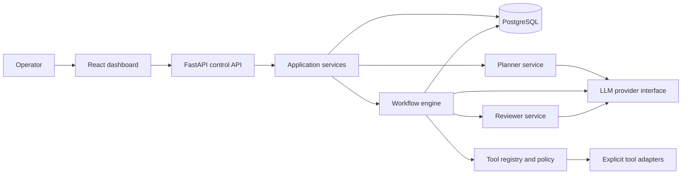
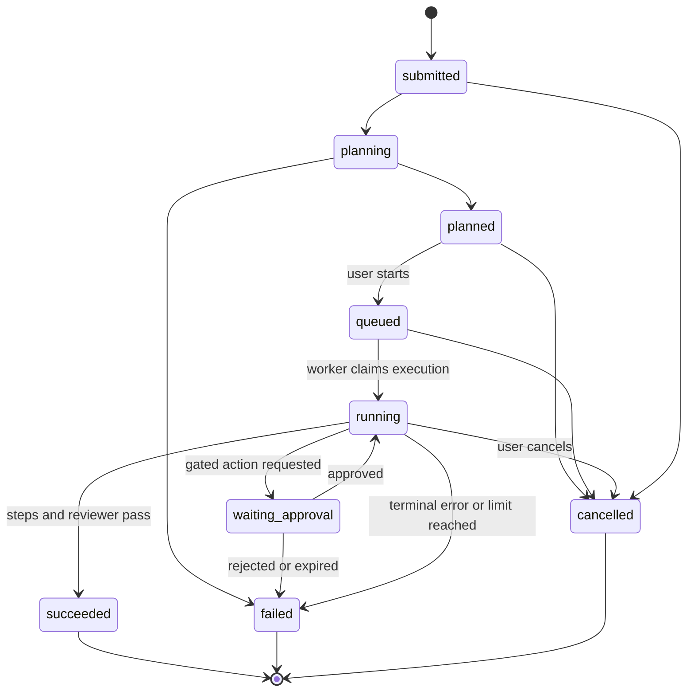
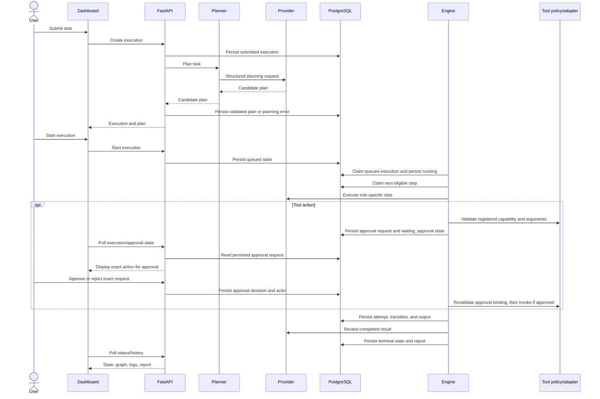

# AgentForge Architecture

## System boundaries

AgentForge separates planning, workflow policy, execution, and provider/tool integrations. Agents are role-specific prompts/adapters invoked by the engine; they are not independent processes with authority to select arbitrary capabilities.

### Component responsibilities

| Component | Owns | Must not own |
|---|---|---|
| React dashboard | Task entry, plan/graph display, start/approve/reject actions, history and logs | Provider credentials, workflow policy decisions, direct tool invocation |
| FastAPI API | Request validation, operator-facing endpoints, auth boundary, service orchestration, response shaping | Agent prompts, DAG scheduling internals, arbitrary execution |
| Pydantic contracts | Versioned request/plan/step/tool/result/state shapes and validation | Persistence or side effects |
| Planner service | Convert task to proposed structured plan through provider interface | Executing plans or tools |
| Workflow engine | Validate transitions and dependency readiness, schedule bounded attempts, persist progress | Provider-specific API details, tool implementations, generated code execution |
| Agent roles | Produce bounded structured outputs for assigned step using only supplied context | Self-directed scheduling or direct registry bypass |
| Tool registry/policy | Resolve registered tool, validate arguments, classify risk, enforce approval and idempotency policy | Allowing tools based solely on model output |
| Provider adapters | Translate provider-neutral requests/results to mock or external LLM APIs | Workflow state, tool permissions, persistence |
| Persistence/repositories | Store versioned plans, executions, attempts, approvals, and audit events | Deciding whether a plan is safe |
| Worker process | Claim and execute queued/resumable work through the same engine | Owning a separate state machine or bypassing API policy |

## Workflow representation

A plan is versioned JSON validated with Pydantic. Each step has a stable ID, role (`researcher` or `analyst`), instruction, declared dependency IDs, typed input/output contract, and optional registered tool capability references. The Planner creates the plan and the Reviewer assesses the completed result; neither is a user-selectable execution-step role in the MVP. A step may produce at most one structured tool request, which the engine validates and dispatches; further tool actions must be represented by subsequent declared steps. The engine owns final validation and execution. Dependencies form a directed acyclic graph.

Plan validation includes:

- schema/version and size limits;
- unique IDs, valid role and tool identifiers;
- valid, non-self dependencies and acyclic graph;
- references only to declared prior outputs;
- bounded prompt/input/output sizes;
- capability checks independent of model intent.

The workflow engine executes sequentially in stable plan order among ready steps. This makes scheduling reproducible and limits initial concurrency/resource complexity. Provider-generated text can still vary.

## Lifecycle and state transitions

State transitions are validated centrally and persisted transactionally. A transition record includes execution, prior/new state, timestamp, actor or system source, and a reason code. Retries are represented as separate attempts for the same step, not as hidden state changes.

**Restart behavior:** the MVP runs a single worker instance and uses a durable database claim to prevent duplicate active work. A lease expiring during an external side effect is ambiguous, not proof of non-execution. On recovery, safe read-only/idempotent work may be retried within limits; a non-idempotent action with unknown outcome is marked `failed` with a recovery-required reason for operator inspection. Exactly-once external effects are not promised. Multiple worker instances are deferred.

## Data flow

## Persistence model (logical)

- **Execution:** ID, original task, state, plan/schema version, provider mode (not credential), timestamps, terminal reason, report.
- **Workflow:** named, versioned validated definition, stored as PostgreSQL JSONB.
- **Workflow step attempt:** execution ID, stable task ID, role, attempt number, input/output JSONB, state, timing, sanitized error.
- **Approval request:** execution/step, action digest, safe display arguments, status, decision time.
- **Tool execution:** execution/step, registered tool name, state, safe input/output summaries, timing.
- **Audit event:** append-only state changes, plan start, approval decisions, and tool invocation outcomes.

Use SQLAlchemy 2.x and Alembic migrations. Store structured data as typed relational fields plus JSONB where appropriate; do not make an unvalidated JSON blob the sole state representation. Do not persist provider secrets. Apply retention and redaction policy before storing prompts/results that may contain sensitive user data.

The initial SQLAlchemy schema is in `backend/app/agentforge/domain/models/`.
It uses UUID primary keys, PostgreSQL JSONB for validated workflow and execution
data, foreign keys with explicit delete behavior, and Alembic migrations.
Execution records may be created before planning completes, so their workflow
reference is nullable until a versioned workflow is available. The MVP's
authentication mechanism remains unresolved; the initial users table stores
only a unique email and does not store a password hash.

## API and worker boundary

The API handles submission, plan retrieval, explicit start/cancel, approval decisions, execution history, and health/readiness. Long-running work is performed outside request handlers by a single worker process using the same application services and engine. For the MVP, PostgreSQL can provide durable queued work and an atomic claim; a separate broker and multiple worker instances are deferred. API calls return execution IDs and clients poll for state rather than keeping long-lived requests open.

Claim/lease duration, heartbeat, recovery, and idempotency rules must be explicit and tested. A 15-minute active execution budget excludes time in `waiting_approval`; an approval request expires after 24 hours and expiry fails the execution without invoking the action.

## Failure handling

| Failure | Required behavior |
|---|---|
| Malformed or unsafe planner output | Reject before execution, persist validation issue, expose actionable error. |
| Provider unavailable, rate-limited, or timed out | Classify error; bounded retry only for transient failures; expose attempts and terminal reason. |
| Tool schema/policy rejection | Do not invoke tool; record denial and fail or pause with clear reason. |
| Approval rejected or expires | Do not invoke gated action; persist decision/expiry and terminate or require replanning. |
| Tool timeout after possible side effect | Treat outcome as ambiguous; do not automatically repeat unless idempotency contract guarantees safe retry. |
| Database unavailable | Fail closed: do not claim/invoke new work without durable state; surface service failure. |
| Worker crash | Recover from persisted state and claim lease; never mark unfinished work successful. |
| Reviewer rejects result | Mark execution failed/review-rejected and show assessment; do not return success. |
| Cancellation | Stop scheduling new steps; cooperative cancellation for active calls; record if an in-flight side effect outcome is unknown. |

## Initial architectural decisions

| ID | Decision | Rationale / consequence |
|---|---|---|
| AD-01 | Represent workflows as versioned Pydantic-validated data, never generated code. | Keeps plans inspectable and prevents code execution from being an implicit capability. |
| AD-02 | Keep planning separate from user-authorized execution. | Prevents a generated plan from immediately causing effects and enables review. |
| AD-03 | Engine owns deterministic sequential scheduling and state transitions. | Makes dependency ordering and recovery testable; parallelism is deferred. |
| AD-04 | Keep provider adapters behind a provider-neutral interface; use a deterministic mock by default in tests/dev. | Core orchestration does not depend on paid APIs or vendor-specific behavior. |
| AD-05 | Tools are explicit registered adapters with typed schemas and deny-by-default policy. | LLM output cannot create new capabilities. Shell/exec tools are excluded. |
| AD-06 | Gate sensitive/external side effects on approval bound to canonical action arguments. | Approval must not authorize a materially changed action. |
| AD-07 | PostgreSQL is the source of truth; API and a single worker are separate runtime roles sharing services. | Durable history and bounded request lifetimes; multiple workers are deferred. |
| AD-08 | MVP targets one trusted operator on a local machine; private-network exposure requires an agreed authentication mechanism. | Avoids pretending minimal MVP controls meet SaaS isolation requirements. |
| AD-09 | Initial limits: 25 steps, 2 retries, 60-second attempts, 15-minute active execution, 10,000-character task, 24-hour approval expiry, and one tool request per step. | Provides testable guardrails; operators can lower these limits. |

## Unresolved questions

1. Which LLM provider(s) are required for Day 2, and what structured-output guarantees do they offer? Default: mock-only in the first vertical slice; provider adapters follow.
2. Which real tools are required for the first release? Default: mock/read-only examples only until each tool has an owner, schema, risk class, and test.
3. Which authentication mechanism should enable private-network exposure? Default: bind the first MVP to loopback only until this is resolved.
4. Which data retention, deletion, and prompt/output redaction rules apply to persisted task content?
5. Who may approve actions, and how should approval expiry, cancellation, and re-planning behave?
6. Is sequential execution acceptable for the first release? Default: yes; concurrency is deferred until load and isolation requirements are measured.
7. What deployment target, backup/restore objective, and supported PostgreSQL version should be certified?

## Scope and feasibility review

The stated feature set is too broad for a single initial implementation milestone if it includes production-grade identity, arbitrary integrations, distributed scheduling, high availability, and a polished dashboard. This architecture narrows the first delivery to a single-operator vertical slice with mock provider/tools, sequential execution, durable status/history, and approval mechanics. The listed scale/performance target is a validation target, not a guarantee.

Approval, persistence, and worker recovery interact: a database claim cannot establish whether a timed-out external effect occurred. The implementation must preserve an ambiguous/recovery-required outcome instead of promising exactly-once execution. Public or multi-user deployment remains out of scope until authentication, authorization, tenant isolation, secrets handling, retention, and operational recovery are specified and tested.
